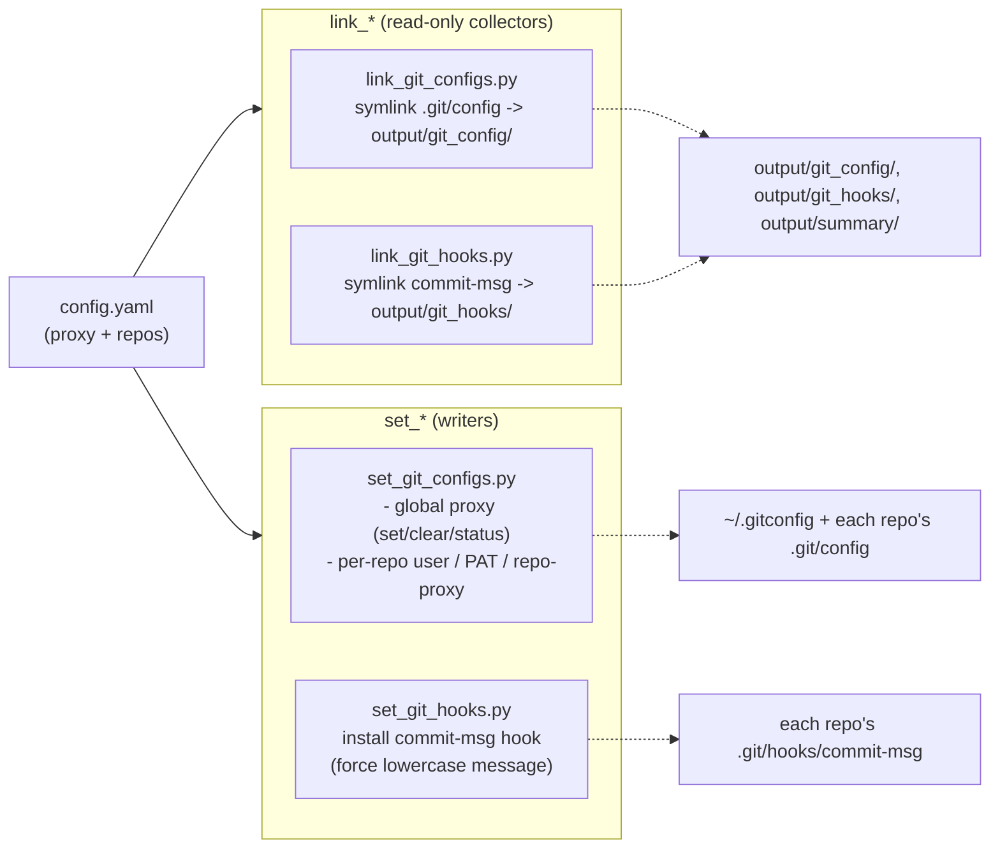

# git-config-manager

> A small toolkit for managing git configuration across many local repositories
> from one place.

If you keep dozens of git repositories on disk (often split across several
GitHub accounts), keeping their configuration consistent is tedious: setting the
right `user.name` / `user.email` per account, authenticating pushes over https,
and toggling a proxy. This toolkit drives all of that from a single
**`config.yaml`**, so you configure once and apply to every repo in bulk.

What it does:

- **Bulk identity & auth** — set `user.name` / `user.email` and embed a GitHub
  **PAT** into each repo's `origin` url, so `git push` needs no interactive
  login and each account's repos are configured correctly.
- **Proxy management** — set / clear the **global** git proxy, and optionally a
  **per-repo** proxy for selected directories.
- **Commit hooks** — install a `commit-msg` hook into every repo that forces the
  commit message to lowercase.
- **Config / hook collection** — gather every repo's `.git/config` and
  `commit-msg` hook via symlinks into one folder for easy inspection.

All settings live in a single **`config.yaml`**. Copy `config.example.yaml`
to `config.yaml` and edit it. `config.yaml` is git-ignored because it contains
secrets (GitHub PATs).

## Project layout

```
git-config-manager/
├── src/
│   ├── config_loader.py      # shared YAML loader
│   ├── link_git_configs.py   # collect .git/config via symlinks
│   ├── link_git_hooks.py     # collect .git/hooks/commit-msg via symlinks
│   ├── set_git_configs.py    # global proxy + per-repo PAT / identity / proxy
│   └── set_git_hooks.py      # install lowercase commit-msg hook in each repo
├── config.example.yaml       # template (committed)
├── config.yaml               # real config (git-ignored, holds PATs)
├── output/                   # generated (git-ignored)
│   ├── git_config/           # symlinks to each .git/config
│   ├── git_hooks/            # symlinks to each .git/hooks/commit-msg
│   └── summary/              # per-target summary tables
├── LICENSE
└── README.md
```

## How it works



Run the scripts from the project root:

```bash
py src/link_git_configs.py    # collect .git/config into output/
py src/link_git_hooks.py      # collect commit-msg hooks into output/
py src/set_git_configs.py     # apply proxy / per-repo config
py src/set_git_hooks.py       # install lowercase commit-msg hook
```

| Script                    | Role                                                                             |
| ------------------------- | -------------------------------------------------------------------------------- |
| `src/link_git_configs.py` | **Read-only collector.** Symlinks each repo's `.git/config` into `output/git_config/`, with an `output/summary/*_git_config_summary.txt` table. |
| `src/link_git_hooks.py`   | **Read-only collector.** Symlinks each repo's `.git/hooks/commit-msg` into `output/git_hooks/`, with an `output/summary/*_git_hooks_summary.txt` table. |
| `src/set_git_configs.py`  | **Writer.** Manages the global git proxy, and injects PAT / name / email / repo proxy into each repo's `.git/config`. |
| `src/set_git_hooks.py`    | **Writer.** Installs a `commit-msg` hook in each repo that lowercases the commit message. Skips repos that already have a foreign hook; `clear_hooks()` only removes hooks it installed. |
| `src/config_loader.py`    | Shared YAML loader (uses PyYAML if installed, else a tiny built-in parser).      |

## License

MIT License. Copyright (c) Orekiyuta.

